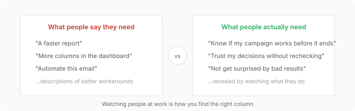
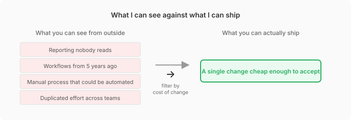

I'm working more closely with business teams this year, and the mistake I keep making is building a fix for the symptom someone described in a meeting rather than for the problem underneath that symptom. So I searched for a better method, and needfinding, from a 1999 paper by Dev Patnaik and Robert Becker, gave me words for what "solve the real problem" actually asks of me.

---

## Needfinding

Most people can't tell you what their real needs are, because years of living with a problem make the problem hard to see. A workaround becomes part of the job and nobody notices the pain anymore, so asking people what would help mostly gets you a description of a better workaround. For this reason needfinding asks you to spend less time asking and more time watching what people actually do. **The gap between what people say and what people do is where you find the needs.**

{fig-alt="What people say they need in a meeting, against what watching the same people at work shows"}

Patnaik and Becker open the paper with the PalmPilot, which shows what finding the need in that gap looks like in a real product. In 1993 Apple released the Newton MessagePad, a handheld that tried to do everything a desktop computer could, and the Newton sold poorly because the device was too slow and too big. Palm had failed the same way with an earlier handheld called the Zoomer, so the Palm team studied how Zoomer customers actually used the device. Those customers used the calendar and the address book, ignored the spreadsheet and the word processor, and nearly all of them bought the optional link to a desktop PC. So people didn't want a small desktop computer at all, people wanted a replacement for their paper organizer, and Palm built the Pilot around that need.

Each row below is 1 team, and the columns follow the team from the team's question to what the team shipped.

| Team | Question the team asked | What the team shipped | Result |
|---|---|---|---|
| Apple | How do we solve every problem of portable computing in 1 device? | Newton MessagePad, with desktop functions in a handheld | Too slow and too big, sold poorly, and Apple canceled the line in February 1997 |
| Palm | Which features do Zoomer customers actually use? | Pilot, with only the address book and day planner, small enough for a shirt pocket and starting instantly when you press the button | The most successful general use handheld on the market by 1999, according to the paper |

The lesson I take from Palm is to avoid naming a solution too early, because the moment you name a solution every other option disappears from the discussion. **Stay with the need for as long as you can.**

---

## In practice

Here's where I get skeptical of the theory. My wife works in luxury retail, and when she talks about her day I can see things that could be better within minutes:

- processes that still run the same way as 5 years ago
- reports that everyone produces and nobody reads
- workflows that a former colleague built years ago and nobody has changed since

From the outside the fix looks obvious, **but knowing the fix and shipping the fix are completely different things.** You can't walk in and say "I watched how you work, and here's what's wrong," because people own their way of working. A step that looks wasteful from the outside might be handling a messy case that would break something else if you removed the step. The step might also be political, because the person who built the process is still on the team.

Patnaik and Becker don't really address this part. The paper treats finding needs as an intellectual problem, **but in practice the hard part is organizational.** You have to get people to accept that their current process has a problem, and you have to get time to observe while everyone expects you to ship the next thing.

{fig-alt="Many problems visible from the outside, filtered by cost of change down to the single change that can ship"}

So the version I'm actually trying to practice is smaller than what the theory suggests. After watching for a while, I pick a single change that's cheap enough for the team to accept rather than trying to fix everything I can see from the outside. Cheap here means the change asks little work and disruption of the people who'd have to adopt the change.

---

## At work

When a stakeholder says "we need a dashboard that shows X," the request is a solution, **and a solution is not a need.** The need behind the request might be "I can't tell if my campaign is working until 2 weeks after the campaign ends," and the request and the need lead to very different builds.

For example, each row below is 1 thing I could build, and the columns say what the stakeholder learns and when.

| What I build | What the stakeholder learns | When the stakeholder learns it |
|---|---|---|
| A dashboard that shows X | The value of X | Whenever the stakeholder opens the dashboard, often after the campaign |
| An early signal of how the campaign is doing | Whether the campaign is on track | In the first days of the campaign, while there's still time to change the campaign |

So I now try to notice earlier when I'm about to build the request instead of the need. Before planning any build, I spend time watching for 3 things:

- what people actually do, as opposed to what people say about their work
- which workarounds the team treats as normal
- what would change for the team if the friction disappeared

---

## References

- Patnaik, D., and Becker, R. (1999). *Needfinding: The Why and How of Uncovering People's Needs.* Design Management Journal, 10(2), 37 to 43. <https://doi.org/10.1111/j.1948-7169.1999.tb00250.x>
